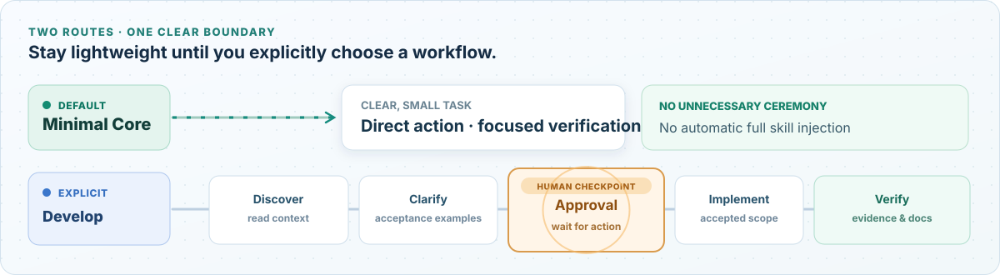
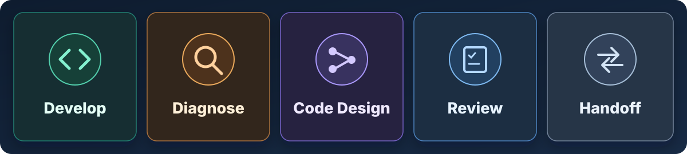
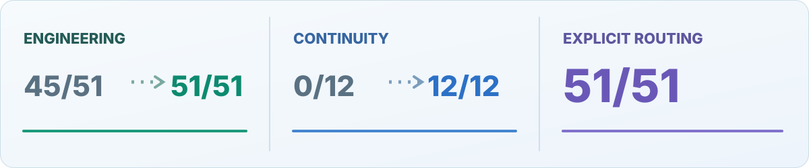

<div align="center">

<a href="https://engineering-flow-web.vercel.app">
  <picture>
  <source media="(max-width: 640px)" srcset="assets/readme/hero-motion-mobile.svg" />
  
</picture>
</a>

<h1>Engineering Flow</h1>

<h3>Minimal by default · Workflows on demand · Ship with evidence</h3>

<p>
  <a href="#quick-start"></a>
  <a href="https://engineering-flow-web.vercel.app"></a>
  <a href="README.md"></a>
</p>

<strong>Codex CLI</strong> · <strong>Claude Code</strong> · <strong>v1.0.4</strong> · <strong>MIT</strong>

</div>

---

## Why Engineering Flow?

<div align="center">

<h3>🪶 Minimal Core　　🎯 Explicit invocation　　🔁 Task continuity</h3>

<h3>🛑 Human approval　　✅ Verified results</h3>

</div>

## How it works

<picture>
  <source media="(max-width: 640px)" srcset="assets/readme/routing-motion-mobile.svg" />
  
</picture>

**Small tasks go straight through. Full workflows are explicit. Develop never codes before approval.**

## Five workflows

<picture>
  <source media="(max-width: 640px)" srcset="assets/readme/workflow-icons-mobile.svg" />
  
</picture>

**💻 Develop** build　·　**🔍 Diagnose** debug　·　**🧠 Code Design** plan　·　**👀 Review** inspect　·　**🤝 Handoff** resume

**Boundaries:** Develop requires approval; Diagnose fixes when requested; Review is read-only by default; Design and Handoff do not modify code.

## Quick start

**Codex CLI**

```bash
codex plugin marketplace add yyqqCoding/engineering-flow-skills
codex plugin add engineering-flow@engineering-flow
```

**Claude Code**

```text
/plugin marketplace add yyqqCoding/engineering-flow-skills
/plugin install engineering-flow@engineering-flow
```

## Try it

```text
$engineering-flow:develop

Implement bulk order export.
Align requirements and acceptance behavior; present the checkpoint and pause.
```

**🛑 Once the checkpoint is accepted, reply:** `Proceed with the plan above.`

Claude Code: `/engineering-flow:develop`. Same-task follow-ups continue without re-invocation.

## Evaluation

<picture>
  <source media="(max-width: 640px)" srcset="assets/readme/evidence-summary-mobile.svg" />
  
</picture>

**Historical data from v1.0.3 and earlier. Separate cohorts; not a v1.0.4 score.**

[Testing method](docs/testing-strategy.md) · [Full results](docs/benchmark-log.md) · [Online evidence](https://engineering-flow-web.vercel.app/en/evidence)

---

<div align="center">

<h3>Build with intent. Ship with evidence.</h3>

<p><a href="docs/user-guide.md">User guide</a> · <a href="docs/product-design.md">Product design</a> · <a href="docs/trigger-model.md">Routing model</a> · <a href="https://engineering-flow-web.vercel.app">Documentation</a></p>

<p><a href="LICENSE">MIT License</a> · <a href="THIRD_PARTY_NOTICES.md">Third-party notices</a></p>

</div>
