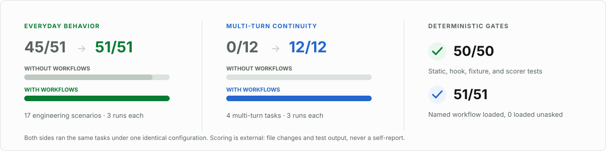

  

  # Engineering Flow

  ### A coding workflow that adds rigor where it matters — without making every task a ceremony.

  **Minimal Core · Explicit workflows · Task-level continuity · Human approval · Verifiable results**

  

    
    
    
  

  

    
    
    
    
  

  [简体中文](README.md) · [**English**](README.en.md) · [User guide](docs/user-guide.md) · [Evaluation evidence](#validation) · [GitHub Issues](https://github.com/yyqqCoding/engineering-flow-skills/issues)

---

> [!IMPORTANT]
> **Not every task needs a full workflow.** Ordinary requests get only the compact Core. Full workflows load only when you explicitly invoke `develop`, `diagnose`, etc. **Answering a clarification question is not permission to start coding.**

## From writing code to consistently delivering correct changes

Strong coding models already know how to inspect code, reuse existing capabilities, debug and test. They do not always apply those habits consistently, especially around **workflow intensity, multi-turn continuity and authorization**. Engineering Flow aligns the process with the task instead of forcing ceremony onto every request.

<table>
  <tr>
    <td width="33%" valign="top">
      <h3>01 / No unnecessary ceremony</h3>
      
<strong>Small, clear tasks proceed directly.</strong>

      
The Core stays minimal; full design, diagnosis, development and review workflows are loaded only when explicitly named.

    </td>
    <td width="34%" valign="top">
      <h3>02 / Continuity across turns</h3>
      
<strong>Approve, correct, resume — keep going.</strong>

      
An invoked workflow owns the task, not just the one message that mentioned it. No repeated invocation for same-task follow-ups.

    </td>
    <td width="33%" valign="top">
      <h3>03 / Finish with evidence</h3>
      
<strong>Align first. Implement. Verify.</strong>

      
Preserve an explicit approval gate, modify the right code boundary and verify the accepted behavior with actual evidence.

    </td>
  </tr>
</table>

## The routing model, at a glance

**The distinction is intentional:** the default stays lightweight. Explicitly invoking `Develop` establishes acceptance behavior, stops at a checkpoint and waits for a separate, unambiguous instruction before coding.

<strong>Read the four engineering principles</strong>

| Principle | Default behavior |
| :-- | :-- |
| **Follow repository truth** | Read project rules, authoritative docs, relevant code and tests; reuse the domain behavior that should evolve together. |
| **Ask material questions only** | Use concrete examples for ambiguity that changes acceptance; infer reversible implementation details from the repository. |
| **Implement and verify by risk** | Establish acceptance examples before implementation, then work and verify in independently meaningful slices. |
| **Finish with evidence** | Check behavior and boundaries, reconcile documentation and only promote durable lessons into project instructions. |

## Five workflows · choose by your goal

These are **five independent entry points, not five mandatory stages**. Develop already covers the design, diagnosis, self-review and delivery needed within a development task.

<picture>
  <source media="(max-width: 640px) and (prefers-color-scheme: dark)" srcset="assets/readme/workflow-map-mobile-dark.svg" />
  <source media="(max-width: 640px) and (prefers-color-scheme: light)" srcset="assets/readme/workflow-map-mobile-light.svg" />
  <source media="(prefers-color-scheme: dark)" srcset="assets/readme/workflow-map-dark.svg" />
  <source media="(prefers-color-scheme: light)" srcset="assets/readme/workflow-map-light.svg" />
  
</picture>

| Workflow | Use it for | Authorization boundary | Codex CLI invocation |
| :-- | :-- | :-- | :-- |
| **Develop** | Features, refactors, tests, implementation improvements | Changes code **only after explicit checkpoint approval** | `$engineering-flow:develop` |
| **Diagnose** | Bugs, regressions, failures, slowdowns | Repairs if authorized in the original request or a later message | `$engineering-flow:diagnose` |
| **Code Design** | New plans or refining an existing design | Proposal only; no production code changes | `$engineering-flow:code-design` |
| **Review** | Diff, branch, PR or uncommitted changes | Read-only by default; fixes specified issues when requested | `$engineering-flow:review` |
| **Handoff** | Continuation across sessions | Records existing decisions and authority; grants none | `$engineering-flow:handoff` |

> Claude Code uses the same workflow names; replace `$engineering-flow:` with `/engineering-flow:`. No full workflow is automatically loaded when it has not been named.

## Quick start

**01 / Install**

<table>
  <tr>
    <th align="left" width="50%">Codex CLI</th>
    <th align="left" width="50%">Claude Code</th>
  </tr>
  <tr>
    <td valign="top"><code>codex plugin marketplace add yyqqCoding/engineering-flow-skills</code>  <code>codex plugin add engineering-flow@engineering-flow</code></td>
    <td valign="top"><code>/plugin marketplace add yyqqCoding/engineering-flow-skills</code>  <code>/plugin install engineering-flow@engineering-flow</code></td>
  </tr>
</table>

<strong>Copyable Codex CLI installation commands</strong>

~~~bash
codex plugin marketplace add yyqqCoding/engineering-flow-skills
codex plugin add engineering-flow@engineering-flow
~~~

<strong>Copyable Claude Code installation commands</strong>

~~~text
/plugin marketplace add yyqqCoding/engineering-flow-skills
/plugin install engineering-flow@engineering-flow
~~~

**02 / Start a new session**

Describe clear, small tasks normally. For a full development workflow, invoke it explicitly:

~~~text
$engineering-flow:develop

Implement bulk order export.
Inspect the current design, owning code boundary and acceptance behavior.
After any necessary clarifications, present the final checkpoint and pause.
Do not commit.
~~~

**03 / Review the checkpoint and give permission**

After checking the scope and acceptance behavior, explicitly reply:

~~~text
Proceed with the plan above.
~~~

Corrections, omitted accepted requirements and same-task continuation remain inside `develop` without a second invocation. Material new scope receives a new incremental checkpoint.

## One task, from the first turn to verified completion

<blockquote>
  
<strong>Invoking a workflow selects the task's operating mode, not a one-message switch.</strong> 
  Answering questions does not silently approve implementation. Reporting an omission does not restart the whole task.

</blockquote>

<strong>Explore approval, correction and repair semantics</strong>

| Your follow-up | What happens |
| :-- | :-- |
| “Read it” or an answer to a clarification question | Remain at the approval checkpoint; no coding authorization |
| “Proceed with the plan above” after the checkpoint | Implement and verify within the approved scope |
| A missing behavior from the accepted requirements | Resume implementation and verification without re-approving the original scope |
| Materially new behavior or changed acceptance | Align only the added scope, then present an incremental checkpoint |
| Cancel, switch workflows or start an unrelated task | End the previous workflow's inheritance and authority |

Diagnose completes authorized repairs and regression verification without switching to Develop. A diagnosis-only request remains read-only until repair is authorized. Review is read-only by default and can fix specific findings on explicit request. Code Design outputs can be reused in Develop, but they do not authorize implementation. Handoff captures existing authority rather than granting more.

## Validation · evidence, not self-reported success

> [!NOTE]
> The chart below shows **historical evidence from v1.0.3 and earlier**. These results are **not** claims about full v1.0.4 performance. Cohorts with different fixtures, scorers, environments or plugin fingerprints are not combined.

<picture>
  <source media="(max-width: 640px) and (prefers-color-scheme: dark)" srcset="assets/readme/evidence-mobile-dark.svg" />
  <source media="(max-width: 640px) and (prefers-color-scheme: light)" srcset="assets/readme/evidence-mobile-light.svg" />
  <source media="(prefers-color-scheme: dark)" srcset="assets/readme/evidence-dark.svg" />
  <source media="(prefers-color-scheme: light)" srcset="assets/readme/evidence-light.svg" />
  
</picture>

**Historical v1.0.3 release gate**

| Evidence | Historical result |
| :-- | --: |
| Static and deterministic tests | **84 / 84 passing** |
| Behavior coverage | **37 scenarios · 47 / 47 behavior IDs** |
| Final fingerprint-matched cohort | **candidate 18 / 18 · control 17 / 18** |
| Contamination and unauthorized commits | **0** |

The final paired cohort covered six scenarios directly related to the Test Contract changes, with 36 complete reports. The candidate scored 3/3 in all six scenarios; the control's one failure involved the previous version's initial approval wording. Earlier cohorts remain separate evidence and are not pooled into these figures.

Historical comparisons also recorded about **17.6% more tool calls** and **16.5% more input tokens** with workflows enabled in one treatment group. This supports invoking full workflows on demand rather than imposing them on all tasks. Current-version costs require fresh measurement.

[Testing method](docs/testing-strategy.md) · [Full benchmark log](docs/benchmark-log.md) · [Online evidence](https://engineering-flow-web.vercel.app/en/evidence)

## Explore the project

<table>
  <tr>
    <td width="33%" valign="top">
      <h3>📖 Usage</h3>
      <a href="docs/user-guide.md">User guide</a> 
      <a href="docs/trigger-model.md">Trigger and routing model</a> 
      <a href="https://engineering-flow-web.vercel.app">Browsable documentation</a>
    </td>
    <td width="34%" valign="top">
      <h3>🏗️ Design</h3>
      <a href="docs/product-design.md">Product design</a> 
      <a href="docs/behavior-spec.md">Behavior specification</a> 
      <a href="CHANGELOG.md">Changelog</a>
    </td>
    <td width="33%" valign="top">
      <h3>🧪 Evidence</h3>
      <a href="docs/testing-strategy.md">Testing strategy</a> 
      <a href="docs/benchmark-log.md">Benchmark log</a> 
      <a href="docs/user-guide.md">Usage scenarios</a>
    </td>
  </tr>
</table>

**Scope:** Engineering Flow focuses on Coding Agent workflows, context, multi-turn interactions and reliable evaluations. It is not a general Agent Runtime and does not take ownership of project issues, branches, commits or releases.

---

  <strong>Build with intent. Ship with evidence.</strong>
  
Fewer rituals. Clearer boundaries. More confidence in every completed change.

  
<a href="https://engineering-flow-web.vercel.app">Documentation</a> · <a href="#quick-start">Get Started</a> · <a href="https://github.com/yyqqCoding/engineering-flow-skills/issues">Feedback</a>

  MIT License · <a href="LICENSE">License</a> · <a href="THIRD_PARTY_NOTICES.md">Third-party notices</a>

