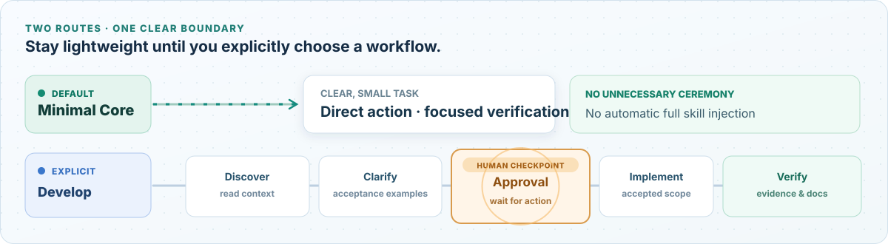
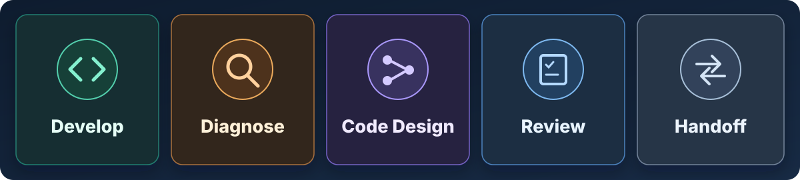

<div align="center">

<a href="https://engineering-flow-web.vercel.app">
  <picture>
  <source media="(max-width: 640px)" srcset="assets/readme/hero-motion-mobile.svg" />
  
</picture>
</a>

<h1>Engineering Flow</h1>

<h3>轻量启动 · 按需工作流 · 用证据交付</h3>

<p>
  <a href="#快速开始"></a>
  <a href="https://engineering-flow-web.vercel.app"></a>
  <a href="README.en.md"></a>
</p>

<strong>Codex CLI</strong> · <strong>Claude Code</strong> · <strong>v1.0.4</strong> · <strong>MIT</strong>

</div>

---

## 为什么选它？

<div align="center">

<h3>🪶 轻量默认　　🎯 显式调用　　🔁 任务不断线</h3>

<h3>🛑 人工批准　　✅ 验证交付</h3>

</div>

## 它如何工作？

<picture>
  <source media="(max-width: 640px)" srcset="assets/readme/routing-motion-mobile.svg" />
  
</picture>

**普通任务直接做。复杂任务点名工作流。Develop 必须获得明确批准才编码。**

## 五个工作流

<picture>
  <source media="(max-width: 640px)" srcset="assets/readme/workflow-icons-mobile.svg" />
  
</picture>

**💻 Develop** 开发　·　**🔍 Diagnose** 诊断　·　**🧠 Code Design** 设计　·　**👀 Review** 评审　·　**🤝 Handoff** 交接

**权限边界：** Develop 批准后实施；Diagnose 按请求修复；Review 默认只读；Design 与 Handoff 不改代码。

## 快速开始

**Codex CLI**

```bash
codex plugin marketplace add yyqqCoding/engineering-flow-skills
codex plugin add engineering-flow@engineering-flow
```

**Claude Code**

```text
/plugin marketplace add yyqqCoding/engineering-flow-skills
/plugin install engineering-flow@engineering-flow
```

## 这样调用

```text
$engineering-flow:develop

实现订单批量导出。
先对齐需求和验收行为，给出实施检查点并暂停。
```

**🛑 检查点确认后回复：** `按上述方案执行。`

Claude Code 调用：`/engineering-flow:develop`。后续同一任务不需要反复点名。

## 验证结果

<picture>
  <source media="(max-width: 640px)" srcset="assets/readme/evidence-summary-mobile.svg" />
  
</picture>

**历史数据：v1.0.3 及更早版本，各评测组独立统计，并非 v1.0.4 成绩。**

[评测方法](docs/testing-strategy.md) · [完整记录](docs/benchmark-log.md) · [在线证据](https://engineering-flow-web.vercel.app/zh-CN/evidence)

---

<div align="center">

<h3>Build with intent. Ship with evidence.</h3>

<p><a href="docs/user-guide.zh-CN.md">用户指南</a> · <a href="docs/product-design.md">产品设计</a> · <a href="docs/trigger-model.md">触发模型</a> · <a href="https://engineering-flow-web.vercel.app">在线文档</a></p>

<p><a href="LICENSE">MIT License</a> · <a href="THIRD_PARTY_NOTICES.md">Third-party notices</a></p>

</div>
