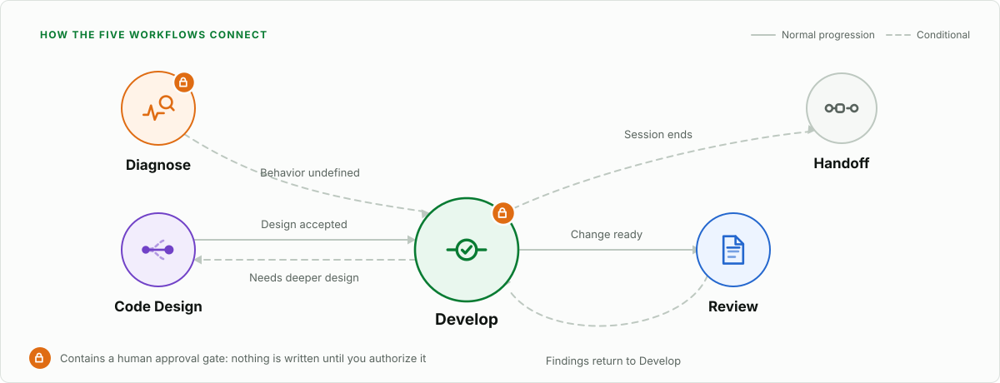
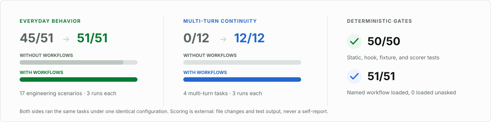

  

  # Engineering Flow

  ### 让 Coding Agent 少走流程，多交付经得起验证的代码。

  **轻量 Core · 显式工作流 · 任务级连续性 · 人工批准边界 · 可复现验证**

  

    
    
    
  

  

    
    
    
    
  

  [**简体中文**](README.md) · [English](README.en.md) · [用户指南](docs/user-guide.zh-CN.md) · [评测证据](#验证结果) · [GitHub Issues](https://github.com/yyqqCoding/engineering-flow-skills/issues)

---

> [!IMPORTANT]
> **不是所有任务都需要完整工作流。** 普通请求默认只加载精简 Core；只有你明确调用 `develop`、`diagnose` 等工作流时，才会进入对应流程。**回答澄清问题 ≠ 批准编码。**

## 从“能写代码”，到“稳定地把事情做好”

强编码模型通常知道如何读代码、复用能力、调试、测试，但容易在**任务复杂度、上下文连续性和授权边界**上表现不稳定。Engineering Flow 不追求给每个任务叠加更多步骤，而是让工作流强度与任务风险相匹配。

<table>
  <tr>
    <td width="33%" valign="top">
      <h3>01 / 不过度流程化</h3>
      
<strong>简单任务，直接完成。</strong>

      
Core 保持精简；设计、诊断、开发、评审等完整流程仅在你明确点名后加载。

    </td>
    <td width="34%" valign="top">
      <h3>02 / 同一个任务不断线</h3>
      
<strong>批准、纠正、补漏，接着做。</strong>

      
显式调用绑定整个任务，而不只是某一条消息；无需每次重复调用工作流。

    </td>
    <td width="33%" valign="top">
      <h3>03 / 用证据结束任务</h3>
      
<strong>先对齐，再实施，再验证。</strong>

      
尊重人工批准检查点，在正确的代码边界实施，并用实际测试和变更证明完成。

    </td>
  </tr>
</table>

## 一眼看懂它如何工作

**关键不是多一套固定流水线，而是两个明确的选择：**不点名工作流时保持轻量；点名 `Develop` 后先建立验收行为，在检查点等待你明确批准，才进入实施与验证。

<strong>展开：四个工程决策原则</strong>

| 原则 | 实际行为 |
| :-- | :-- |
| **以仓库事实为准** | 先读项目规则、权威文档、相关代码和测试；优先复用真正应该共同演进的领域能力。 |
| **只问关键问题** | 以具体实例澄清影响验收的未知行为；可由仓库推断的可逆实现细节自主处理。 |
| **按风险组织实现** | 在实施前确定验收实例，然后按可验收行为逐段实现、逐段获取反馈。 |
| **完成要有依据** | 验证功能与边界，修复文档偏差；只有长期有用的经验才沉淀到规则文件。 |

## 五个工作流 · 按目标选择入口

不是五个必须依次执行的阶段，而是**五个独立入口**。Develop 会在其任务内完成必要的设计、诊断、自检和交付；只有需要独立产物时，才另选工作流。

<picture>
  <source media="(max-width: 640px) and (prefers-color-scheme: dark)" srcset="assets/readme/workflow-map-mobile-dark.svg" />
  <source media="(max-width: 640px) and (prefers-color-scheme: light)" srcset="assets/readme/workflow-map-mobile-light.svg" />
  <source media="(prefers-color-scheme: dark)" srcset="assets/readme/workflow-map-dark.svg" />
  <source media="(prefers-color-scheme: light)" srcset="assets/readme/workflow-map-light.svg" />
  
</picture>

| 工作流 | 适用场景 | 权限边界 | Codex CLI 调用 |
| :-- | :-- | :-- | :-- |
| **Develop** | 功能、重构、补测试、改进实现 | **检查点获得明确批准后**改代码 | `$engineering-flow:develop` |
| **Diagnose** | Bug、回归、故障、性能问题 | 初始请求或后续消息授权修复时改代码 | `$engineering-flow:diagnose` |
| **Code Design** | 新方案设计、既有方案完善 | 只输出方案，不修改生产代码 | `$engineering-flow:code-design` |
| **Review** | Diff、分支、PR、未提交改动 | 默认只读；明确要求后修复指定问题 | `$engineering-flow:review` |
| **Handoff** | 跨会话交接任务进度 | 保存状态与现有授权，不创造新授权 | `$engineering-flow:handoff` |

> Claude Code 使用相同的工作流名称，将 `$engineering-flow:` 替换为 `/engineering-flow:`。完整工作流默认不会由模型自行触发。

## 2 分钟快速开始

**01 / 安装插件**

<table>
  <tr>
    <th align="left" width="50%">Codex CLI</th>
    <th align="left" width="50%">Claude Code</th>
  </tr>
  <tr>
    <td valign="top"><code>codex plugin marketplace add yyqqCoding/engineering-flow-skills</code>  <code>codex plugin add engineering-flow@engineering-flow</code></td>
    <td valign="top"><code>/plugin marketplace add yyqqCoding/engineering-flow-skills</code>  <code>/plugin install engineering-flow@engineering-flow</code></td>
  </tr>
</table>

复制命令更方便：

<strong>Codex CLI · 完整安装命令</strong>

~~~bash
codex plugin marketplace add yyqqCoding/engineering-flow-skills
codex plugin add engineering-flow@engineering-flow
~~~

<strong>Claude Code · 完整安装命令</strong>

~~~text
/plugin marketplace add yyqqCoding/engineering-flow-skills
/plugin install engineering-flow@engineering-flow
~~~

**02 / 开启新会话，按目标调用**

普通小任务直接描述即可。需要完整开发流程时，输入：

~~~text
$engineering-flow:develop

实现订单批量导出。
先检查现有设计、代码边界与验收行为。
完成必要澄清后给出最终检查点并暂停，不要提交。
~~~

**03 / 确认检查点，再授权执行**

当 Agent 提供完整检查点，你确认范围与验收项无误后，再明确回复：

~~~text
按上述方案执行。
~~~

后续同一任务的纠正、漏项补充和继续实施，无需重新调用 `develop`；扩大验收范围时会对**新增部分**重新对齐。

## 一个任务，从第一条消息持续到交付

<blockquote>
  
<strong>显式调用是任务入口，不是每条消息的开关。</strong> 
  既不能因为你回答了问题就擅自开工，也不该因为你补充了一条验收项就要求从头再来。

</blockquote>

<strong>查看 Develop / Diagnose / Review 的多轮行为与授权规则</strong>

| 你说了什么 | 工作流如何继续 |
| :-- | :-- |
| “已阅读”或回答澄清问题 | 继续等待实施批准，不把它当作授权 |
| 在检查点之后说“按上述方案执行” | 进入已批准范围的实施与验证 |
| 指出已经接受的验收项漏做了 | 继续实现和验证，不必重新批准原范围 |
| 新增功能或实质改变验收行为 | 仅对新增范围重新对齐并给出增量检查点 |
| “取消”、切换工作流、开始无关任务 | 结束旧工作流，不继承旧任务授权 |

Diagnose 如原请求已明确授权修复，可直接完成复现、诊断、修复和回归验证；如果只要求诊断，则先保持只读。Review 默认只读，只有明确要求修复指定问题才进入获授权的修复。Code Design 已形成的方案可供 Develop 复用，但不会自动获得编码授权。Handoff 只记录任务状态和已有授权。

## 验证结果 · 不是模型的自我报告

> [!NOTE]
> 下列图表是 **v1.0.3 及更早版本的历史评测证据**，不能当作 v1.0.4 当前版本的全量成绩。不同指纹、环境和评分器的 cohort 不混算。

<picture>
  <source media="(max-width: 640px) and (prefers-color-scheme: dark)" srcset="assets/readme/evidence-mobile-dark.svg" />
  <source media="(max-width: 640px) and (prefers-color-scheme: light)" srcset="assets/readme/evidence-mobile-light.svg" />
  <source media="(prefers-color-scheme: dark)" srcset="assets/readme/evidence-dark.svg" />
  <source media="(prefers-color-scheme: light)" srcset="assets/readme/evidence-light.svg" />
  
</picture>

**历史 v1.0.3 发布门禁**

| 检查项 | 历史结果 |
| :-- | --: |
| 静态与确定性测试 | **84 / 84 通过** |
| 行为覆盖 | **37 个场景 · 47 / 47 行为 ID** |
| 最终指纹配对 cohort | **candidate 18 / 18 · control 17 / 18** |
| 污染与未授权提交 | **0** |

这里的最终配对 cohort 使用当时 Test Contract 变更直接相关的 6 个场景、36 个完整报告；candidate 的 6 个场景均为 3/3，control 唯一未通过项是旧版本的初始批准措辞。不同历史 cohort **不合并计算**。其他早期对照中，启用工作流的一组平均工具调用多约 17.6%、输入 token 多约 16.5%，也说明按需调用而非一律开启很重要。

  <a href="docs/testing-strategy.md"><strong>评测方法</strong></a> ·
  <a href="docs/benchmark-log.md"><strong>完整记录</strong></a> ·
  <a href="https://engineering-flow-web.vercel.app/zh-CN/evidence"><strong>在线查看证据</strong></a>

## 继续探索

<table>
  <tr>
    <td width="33%" valign="top">
      <h3>📖 使用</h3>
      <a href="docs/user-guide.zh-CN.md">用户指南</a> 
      <a href="docs/trigger-model.md">触发与路由模型</a> 
      <a href="https://engineering-flow-web.vercel.app">可浏览的在线文档</a>
    </td>
    <td width="34%" valign="top">
      <h3>🏗️ 设计</h3>
      <a href="docs/product-design.md">产品设计</a> 
      <a href="docs/behavior-spec.md">行为规范</a> 
      <a href="CHANGELOG.md">版本更新记录</a>
    </td>
    <td width="33%" valign="top">
      <h3>🧪 证据</h3>
      <a href="docs/testing-strategy.md">测试策略</a> 
      <a href="docs/benchmark-log.md">基准运行日志</a> 
      <a href="docs/user-guide.zh-CN.md">使用场景说明</a>
    </td>
  </tr>
</table>

**项目定位：** Engineering Flow 聚焦 Coding Agent 的工作流、上下文、多轮交互和可靠性评测；不是通用 Agent Runtime，也不接管项目的 Issue、分支、提交或发布。

---

  <strong>Build with intent. Ship with evidence.</strong>
  
让代码不仅能跑，也知道为什么这样实现、凭什么说已经完成。

  
<a href="https://engineering-flow-web.vercel.app">Documentation</a> · <a href="#快速开始">Get Started</a> · <a href="https://github.com/yyqqCoding/engineering-flow-skills/issues">Feedback</a>

  MIT License · <a href="LICENSE">License</a> · <a href="THIRD_PARTY_NOTICES.md">Third-party notices</a>

